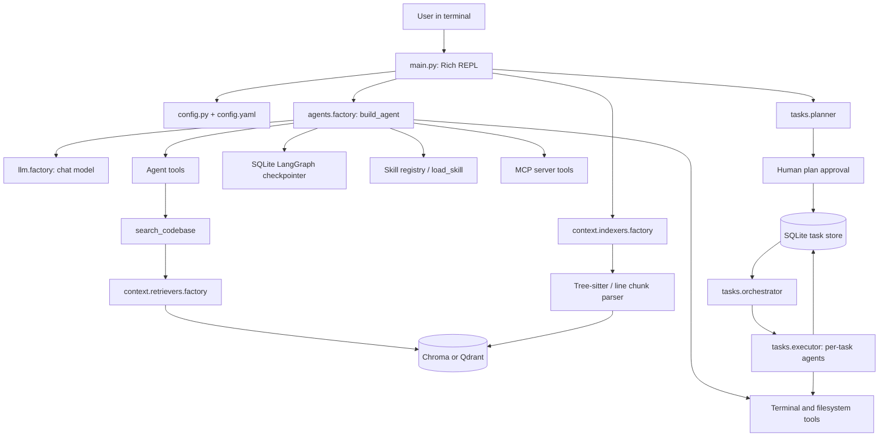

# Claude Code: Architecture and Design

## 1. Project purpose

Claude Code is a Python command-line coding assistant for working in the current directory. Its main interaction loop is a Rich REPL. It can answer questions about a codebase using retrieval-augmented generation (RAG), retain conversational state across runs, load optional skills, call tools exposed by configured Model Context Protocol (MCP) servers, and plan and execute multi-step software tasks.

The package targets Python 3.12 or newer and is installed as the `claude_code` package. The `claude_code` console command maps to `claude_code.main:run` (see `pyproject.toml`).

## 2. System overview

The application has two main workflows:

1. **Codebase Q&A:** parse/index the current project, retrieve relevant chunks for a question, and pass the retrieved code to a tool-using chat agent.
2. **Task execution:** ask an LLM to produce a structured plan, let the user approve or revise it, save tasks in SQLite, and execute dependency-ready tasks with focused agents.

## 3. Startup and command flow

`claude_code.main` loads `.env` from the directory above the package, configures the Rich console and logger, and opens an asynchronous SQLite checkpointer. Initialization creates the configured LLM and embedder, obtains an index for `Path.cwd()`, builds the agent, and loads or creates a conversation session ID. The REPL dispatches commands:

| Command | Behavior |
| --- | --- |
| `/ask <question>` | Calls the agent with the current session's thread ID and prints its final response. |
| `/plan <goal>` | Starts or resumes the planning and task execution workflow. |
| `/task_status` | Displays task progress for the latest approved project. |
| `/show_index` | Displays indexed chunks using the configured index inspector. |
| `/new_session` | Creates a new UUID session. |
| `/switch <session_id>` | Selects an existing or new thread ID. |
| `/session` | Prints the current session ID. |
| `/exit`, `/quit` | Leaves the REPL. |

Unrecognized input prints command help. Questions need the `/ask` prefix.

## 4. Codebase Q&A architecture

### Agent composition

`agents.factory.build_agent` creates a LangChain agent from the configured chat model. It adds the core system prompt, a compact summary of installed skills (if any), the SQLite-backed LangGraph checkpointer, and summarization middleware. Its toolset includes:

- `search_codebase` for retrieving code snippets relevant to a question.
- `load_skill` for loading a selected skill's full instructions on demand.
- `run_command` for executing a shell command.
- Tools discovered from configured MCP servers.

Filesystem tools are imported in the factory but are not currently added to this main Q&A agent's tool list. Task agents have a separately scoped filesystem toolset (see below). The system prompt asks the model to search the codebase before answering and cite file names, functions, and line numbers.

`agents.orchestrator.handle_query` invokes the agent asynchronously with `configurable.thread_id` set to the active session ID. The last message content is returned to the CLI; exceptions are logged and returned as an error string.

### Indexing and parsing

`context.indexers.code_parser` finds supported files recursively beneath the current working directory. It ignores common generated or environment directories (`.venv`, `venv`, `__pycache__`, `.git`, `node_modules`, `dist`, `build`). Supported source languages are Python, JavaScript/TypeScript, Java, Go, Rust, C/C++, C#, Ruby, PHP, Swift, Kotlin, and shell. Markdown and common text/config formats are also supported.

For source languages, Tree-sitter extracts named top-level function, method, class, and related AST blocks. Nested blocks are not separately indexed after an enclosing block is captured. Files with no recognized blocks fall back to overlapping line windows. Text/config files use 50-line windows with 10-line overlap. Each chunk carries content, absolute source path, name, type, and inclusive line bounds.

The indexer factory selects an implementation using `rag.mode` and `vector_store.provider`:

| Provider/mode | Index implementation | Retrieval implementation | Storage |
| --- | --- | --- | --- |
| Qdrant + hybrid | `indexers.hybrid_qdrant` | `retrievers.hybrid_qdrant` | Qdrant dense + BM25 sparse vectors |
| Qdrant + non-hybrid | `indexers.semantic_qdrant` | `retrievers.semantic_quadrant` | Qdrant dense vectors |
| Other provider | `indexers.semantic_chroma` | `retrievers.semantic_chroma` | Persistent local ChromaDB |

The hybrid Qdrant integration supports dense, sparse, and hybrid retrieval according to `vector_store.retrieval_mode`. Retrieval returns the top five chunks by default, normalized to content, source, name, type, line bounds, and score/distance. `search_codebase` formats those results for the model.

### Important indexing behavior

The Qdrant indexers reuse a non-empty collection as-is; they do not compare it with the current repository or reindex changed files. The Chroma indexer walks files and upserts chunks each time it is called. Its IDs derive from file path, chunk name, and starting line. In either case, the index represents project code as of indexing and may need an explicit refresh after changes. A successful `/plan` run attempts to index the current directory again.

## 5. Model and configuration design

`config.py` loads `claude_code/config.yaml` once at import time into the module-level `config` dictionary. `llm.factory` chooses OpenAI or Anthropic chat models from `llm.provider`; embeddings choose Hugging Face when configured and otherwise OpenAI. The same configured embedding model should be used for indexing and querying.

The checked-in YAML currently defines these groups:

| Group | Purpose / current values |
| --- | --- |
| `llm` | Provider and chat model (`openai`, `gpt-4o` in the checked-in file). |
| `embeddings` | Embedding provider and model (`openai`, `text-embedding-3-small`). |
| `rag` | Retrieval/indexing mode (`hybrid`). |
| `vector_store` | Backend (`qdrant`) and retrieval mode (`hybrid`). |
| `qdrant` | Qdrant collection name (`codebase3`). Connection URL/key come from `QDRANT_URL` and `QDRANT_API_KEY`. |
| `chromadb` | Local persistence path and collection for the Chroma implementation. |
| `memory` | Checkpoint DB path, summarization threshold, and retained message count. |
| `skills` | Skills directory, relative to the current project working directory. |

The YAML also includes Elasticsearch settings, but there is no Elasticsearch adapter in the current indexer/retriever factories. Environment variables such as model credentials are supplied through the provider SDKs; `.env` is loaded at startup.

## 6. Conversation memory and sessions

The REPL opens `AsyncSqliteSaver` at the configured `memory.db_path` and supplies it as the LangGraph checkpointer. Each conversation session is a UUID used as a LangGraph thread ID. The selected ID is stored in a sibling `current_session` file, allowing the CLI to resume that thread in later runs. Starting a new session changes the active ID but leaves earlier checkpoints in SQLite.

`SummarizationMiddleware` uses the configured chat model and summarizes when conversation tokens reach the configured threshold, retaining the configured recent messages. `memory.short_term` also has synchronous checkpointer/history helpers, though the main REPL uses the async saver.

## 7. Skills and MCP extensions

### Skills

Skills are loaded from `Path.cwd() / skills.skills_dir` (default `.claude_code/skills`). Each skill is a subdirectory containing `SKILL.md`, optionally with YAML frontmatter (`name`, `description`, `when_to_use`) and supporting files. `SkillRegistry` loads metadata and instruction bodies into a process-wide, lazy singleton. Only metadata is added to the system prompt; `load_skill` returns the full instructions when selected and lists support-file paths. The agent can then use file tools available in its workflow to read referenced resources.

### MCP

`mcp.claudeCode_mcp_config` reads `claude_code/claude_code_mcp_servers.json` and substitutes `${ENV_VAR}` placeholders. `mcp.ClaudeCode__mcp_client` creates a `MultiServerMCPClient` and retrieves tools from configured servers at agent startup. The supplied configuration defines a GitHub stdio server launched with `npx` and expects `GITHUB_TOKEN`. If a configured server cannot connect, agent construction can fail because discovery happens during `build_agent`.

## 8. Planning and task execution

### Planning and approval

`tasks.planner.create_plan` asks the configured model for an `ExecutionPlan`, validated by Pydantic. The plan contains project metadata and 5–20 tasks with IDs, type, description, dependencies, expected output files, estimated duration, and acceptance criteria. `tasks.approval` renders a Rich table and lets the user approve, edit a task description, or reject and provide feedback for replanning.

### Persistence and scheduling

`tasks.task_store.SQLiteTaskStore` stores projects and tasks in a separate SQLite DB (default `.claude_code/tasks.db`). Each operation uses a short-lived connection with WAL mode and foreign keys. Task states are `pending`, `in_progress`, `completed`, `failed`, `blocked`, or `skipped`. Claims and state updates are persisted atomically. Dependencies are stored as JSON lists, as are output files and acceptance criteria.

`tasks.orchestrator.TaskOrchestrator` defaults to one concurrent task. It queries pending tasks whose dependencies are completed or skipped, claims them, injects completed dependency results into the task prompt, and dispatches each to an agent. Failures are retried up to the task's retry limit; exhausted tasks are marked failed. When a task fails, dependent tasks are not eligible, and the orchestrator can report that remaining work is blocked. The `RecoveryManager` resets tasks left in progress after a crash, retrying them when attempts remain.

### Per-task agents and judging

`tasks.executor.run_subtask_agent` builds a fresh agent for each task, without sharing a conversation checkpointer. It chooses tools by task type to limit the available operations: design and review tasks are read/write focused; implementation, test, integration, and configuration tasks receive other filesystem operations, and test/integration tasks may run commands. The prompt includes task details, acceptance criteria, requested output files, and dependency results.

After the agent returns, a separate LLM judge evaluates the task output against its acceptance criteria. A verdict passing at score 6 or above completes the task; a lower score raises an error and enters the retry path. Once orchestration ends, `/plan` tries to rebuild the code index so generated files can be queried.

`/plan` currently resumes the latest approved project found in the task DB before creating a new plan. It does not select a project by matching the new goal.

## 9. Tool and observability design

`tools.filesystem_tools` exposes read, write, append, delete, directory listing, and existence checks. Reads are limited to 10 MiB. Errors are returned as strings. `tools.terminal_tools` exposes shell execution with a 30-second timeout, stdout/stderr capture, and a small exact-substring blocked-command list. These are convenience controls, not a comprehensive sandbox; tool access should be treated as access to the host process's filesystem and command environment.

`observability.logger` configures a warning-level root logger to reduce third-party noise and returns package loggers at DEBUG. Modules log major lifecycle steps, tool calls, retrieval, and task transitions. User-facing progress and tables are printed through Rich.

## 10. Package map

| Path | Responsibility |
| --- | --- |
| `claude_code/main.py` | Application entry point, initialization, CLI command loop. |
| `claude_code/config.py`, `config.yaml` | YAML loading and runtime configuration. |
| `claude_code/agents/` | Main Q&A agent construction, query orchestration, search tool. |
| `claude_code/llm/` | Chat model and embedding provider factories. |
| `claude_code/context/indexers/` | Source parsing, vector indexing, index inspection, backend selection. |
| `claude_code/context/retrievers/` | Backend-specific similarity retrieval and selection. |
| `claude_code/memory/` | LangGraph SQLite checkpoints, summarization settings, session IDs. |
| `claude_code/tasks/` | Plan schema, user approval, SQLite store, execution, retry/recovery, status. |
| `claude_code/skills/` | Skill discovery, metadata prompt construction, on-demand instructions. |
| `claude_code/tools/` | Filesystem and shell tools. |
| `claude_code/mcp/` | MCP config resolution and tool discovery. |
| `claude_code/observability/` | Logging setup. |

## 11. Design characteristics and maintenance notes

- **Factory-based backend selection:** indexers and retrievers are chosen independently from central factories, which keeps backend-specific operations out of the agent tool.
- **Progressive context loading:** code is retrieved per query, skills expose metadata first and full instructions on demand, and dependency summaries are injected only into downstream task agents.
- **Durable state:** chat checkpoints and task progress use SQLite, while vectors live in Chroma or Qdrant.
- **Focused task permissions:** task-type-specific tool lists limit each subagent's capabilities relative to giving every task the same tools.
- **Single-user CLI assumptions:** configuration is global and loaded once, skill registry is process-wide, sessions use a single current-session file, and plan scheduling is serial by default.
- **Index freshness is external to Qdrant:** existing non-empty Qdrant collections are reused without freshness checks. Consider adding repository fingerprints or incremental update/deletion handling if automatic freshness is required.
- **Paths depend on the working directory:** indexing, skill discovery, and default task data paths target the directory from which the CLI is launched. Run the command from the project intended for analysis and modification.
- **Tests and packaging:** the repository currently contains no test directory in the tracked file inventory. Add focused tests around parser chunking, factory routing, task state transitions, and tool security as these areas evolve.

## 12. Runtime setup summary

1. Install the package and its Python 3.12+ dependencies using Poetry.
2. Set credentials for the selected model and embedding providers.
3. For the default Qdrant configuration, provide `QDRANT_URL` and, when required, `QDRANT_API_KEY`; make the service reachable.
4. For the configured GitHub MCP server, provide `GITHUB_TOKEN` and ensure `npx` is available, or edit the MCP server configuration.
5. Run `claude_code` from the target repository directory. Use `/ask` for codebase questions and `/plan` for an approved multi-step implementation workflow.

